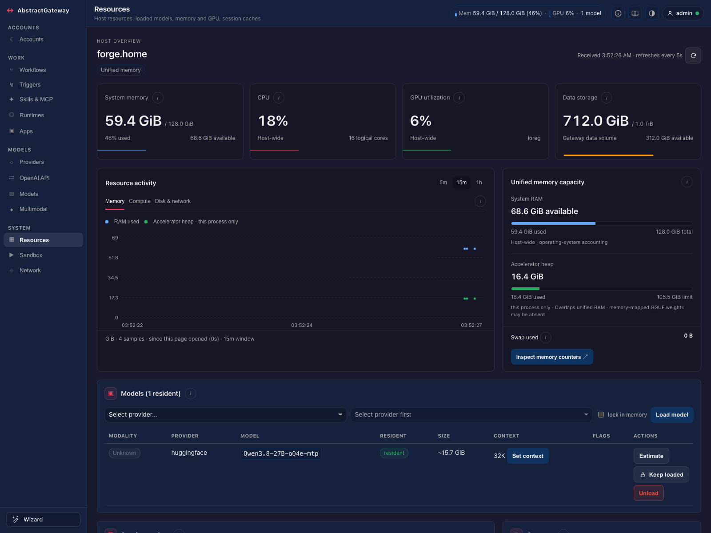
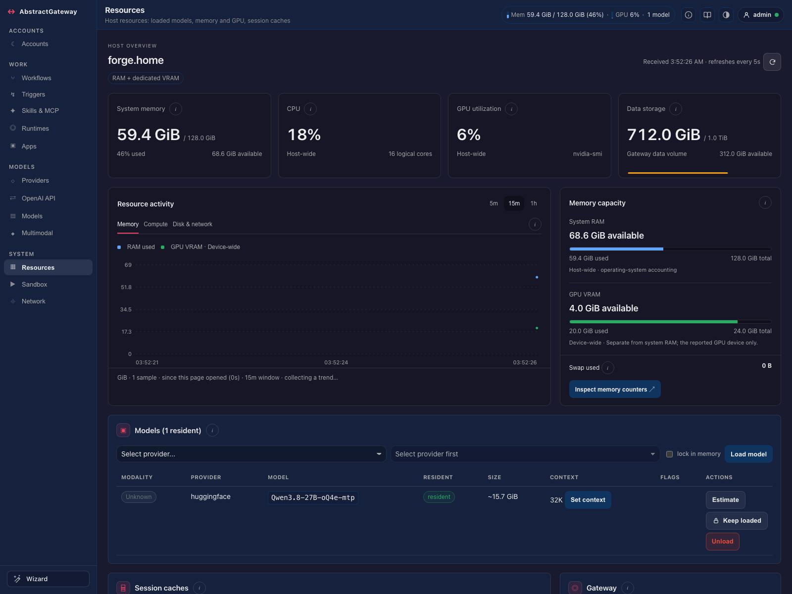

# Resources implementation

Implemented in the actual Gateway console on 2026-10-30. The original standalone
prototype remains a historical design reference; it is not the production shell.

The implementation keeps AbstractUIC's theme chooser and the reserved top-right
docs assistant, About, appearance and clickable account/status widgets. All new
content uses the existing kit tokens, tooltips and modal binding. The implementation was subsequently redeployed to the operator's existing local
gateway on 2026-10-30 through its graceful restart endpoint. No dependency or
service configuration was changed.

## Memory layouts

- **Unified memory:** one system RAM pool; scoped accelerator heap explicitly
  overlaps RAM. Heap headroom is not presented as allocatable RAM. The wired
  accelerator ceiling is labeled a limit, not installed capacity.
- **Separate RAM and GPU memory:** independent capacity bars and headroom.
  CUDA device-wide total/free determines VRAM use; process-local allocation does
  not replace that counter. The reported GPU device is the scope, not every GPU.
- Explicit topology/`unified_memory` evidence takes precedence (including
  integrated CUDA). MLX Metal identifies unified memory when topology is absent;
  MPS additionally requires same-host Apple Silicon evidence.
  Intel/unknown MPS remains unreported. CUDA with no explicit physical topology is labeled RAM + GPU VRAM;
  unknown backends stay unreported rather than inventing dedicated capacity.
- Model weights, caches, process memory and hardware counters may overlap; the
  inspector preserves their measurement scopes and estimate markers.

These screenshots use route-controlled test fixtures in the real served console,
not measurements of the operator's machine.

## Metrics and controls

The existing host snapshot gains an additive `system` section: CPU, load average,
logical cores, data-volume capacity, swap usage, and interval disk/network rates.
Each probe fails independently. First intervals and counter resets stay unknown.
Optional psutil absence degrades the affected probes; disk capacity still works.
The shared sampler runs on the existing host-state worker and does not start a
thread, daemon, background service or persistent store.

Graphs contain actual browser observations, bounded to an hour/720 samples,
labeled **since this page opened**. They preserve missing intervals and reset at
measurement-scope/host/account boundaries. Browser receipt time avoids clock skew;
the source timestamp remains available on the freshness info. They do not imply
collection while the page is closed. Retained telemetry, serving latency/rates,
loop lag, OS pressure and thermal probes are tracked in proposed item 0982.

Load, unload, keep loaded, context, estimate, cache clear and workflow pause/resume
reuse the existing handlers and permissions. Update/start-at-login/restart/quit
remain in the Gateway inspector; no duplicate API or authorization system exists.

## Validation and traceability

The Chromium browser test covers shared widgets and account menus, both memory
layouts, failed/unknown readings, keyboard info/inspectors/charts, series changes,
five widths (320–1600), both shared light/dark themes, read-only visibility,
confirmed/cancelled/failed unload, load, lock/unlock, cache clear, pause/resume and
the absence of unrequested network/mutation calls.

Core tests cover topology selection, independent CUDA counters, history bounds,
counter delta math, warm-up/reset/failure, concurrent sampling, the additive host
state, existing model/host routes, import boundaries, parsing and responsiveness.

Final result: **124 pytest tests passed; 96 Chromium browser checks passed**.
The two baseline failures below were explicitly deselected in the final gate
after being reproduced separately. The [validation receipt](integration-validation.json)
records the implementation commit and scope. [Light theme](integrated-light.png)
and [mobile](integrated-mobile.png) screenshots are also available.
An additional 37-test focused pass validated the MPS hardware-evidence hardening,
including Apple Silicon, Intel/unknown MPS and a different host's hardware.

Two broader tests reproduce failures at the untouched baseline `0bfe34d5`:
`test_gateway_model_residency_capability_contract_comes_from_runtime_host_facade`
and `test_pause_resume_routes_and_health_flag`. The installed Runtime metadata is
0.15.2; the pre-existing Gateway gate requires 0.15.3. No Runtime files, dependency
installations or version gates were changed for this work.

Work records: [0980 dashboard](../../docs/backlog/completed/resources/0980_resources_dashboard_and_memory_topology.md),
[0981 sampling](../../docs/backlog/completed/resources/0981_host_cpu_storage_and_swap_metrics.md),
[0982 proposed telemetry](../../docs/backlog/proposed/0982_resources_retained_history_and_serving_metrics.md).

## Live deployment

The operator explicitly requested redeployment after implementation. Code `37ccd5f8`
is live at <http://127.0.0.1:8080/console#models>. Health and the model host are
healthy; authenticated live CPU/storage/swap/I/O observations render correctly.
A live browser verified the unified-memory layout, inspector, shared appearance
dialog and account menu, with no JavaScript exceptions or server errors.
The deployed environment has Runtime 0.15.3; the earlier development-test version
gate does not apply to this instance. See the deployment section of the
[validation receipt](integration-validation.json).
