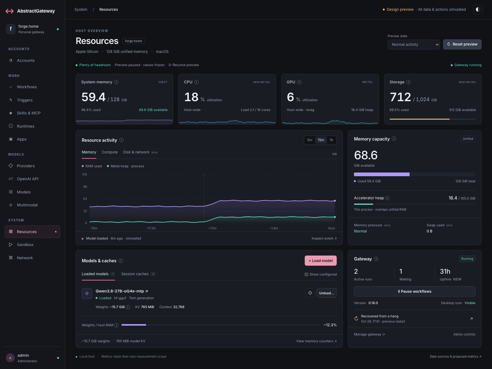

# Resources: host overview and resource controls

Design proposal · 2026-10-30 · implementation-ready direction, simulated preview.

**Implemented:** see [the actual console integration](IMPLEMENTATION.md), including
unified RAM and separate VRAM, and the preserved shared AbstractUIC header/themes.
The text and standalone preview below record the original proposal; their local
chrome and simulated data are not used by the implemented console.

Open [index.html](index.html) directly in a browser. It has no dependencies or network calls. A local preview is also available while the preview server is running:

```sh
# From the AbstractFramework workspace root:
python3 -m http.server 8766 --bind 127.0.0.1 --directory abstractgateway/design/resources
```

Visit <http://127.0.0.1:8766>. All readings and operations are simulations. The console implementation and running gateway have not been changed. The sidebar provides visual context; other console pages are outside the preview.



## Design direction

Answer four questions, in order: **Is the host healthy? What changed? What is consuming resources? What can I do about it?**

The screenshot spends its first large card on gateway administration. Its capacity counters repeat below long explanations, while model controls fall below the fold. The proposal puts resource status first and makes gateway management a compact adjacent card.

- Four glanceable cards: system RAM, CPU, GPU utilization, storage. Each has a short trend or capacity bar and an inspect action.
- One shared timeline with Memory, Compute, and Disk & network views; selectable ranges, series visibility, pointer inspection, touch inspection, and keyboard sampling.
- A capacity panel distinguishes host RAM from the overlapping accelerator counter. Scope is visible next to the number. Only used and available RAM form a partition.
- A compact Models & caches surface keeps load, keep-loaded, unload, context, and cache controls together. Configured models remain opt-in and never inflate the loaded count.
- A small Gateway card exposes runner status, active/waiting work, pause, and the last restart. Update, login, restart, and quit belong in its inspector.
- Explanatory material moves to **(i)** popovers and inspectors. Measurement scope, estimates, stale data, access restrictions, and operation consequences remain visible at the point of use.

The palette uses charcoal surfaces, restrained rose navigation/action accents, violet RAM, and teal accelerator data. Color reinforces labels. Thin borders replace large blue panels. Dark and light themes and a mobile single-column layout are included.

## Try the interactions

1. Hover, focus, or tap an **(i)**. Escape dismisses it. Inspect a metric by clicking its label or card.
2. Scrub the chart, or focus it and use Left/Right/Home/End. Toggle a series and compare 5m, 15m, and 1h. The simulated load event stays eight minutes in the past and falls outside the 5m window.
3. Keep the model loaded: unloading becomes unavailable until unlocked. Unload, cancel, confirm, and load it again. These operations change local preview inventory only.
4. Show configured models. Switch to Session caches and clear one. Clearing preserves the simulated model inventory.
5. Pause and resume workflow steps. The confirmation explains that in-flight calls finish and other entity processes are outside this pause's scope.
6. Select Memory pressure, GPU probe unavailable, No models loaded, or Read-only account. The unavailable state retains a stale last reading separately from the unavailable current value.
7. Open the restart incident, gateway management, memory counters, or source coverage. Switch theme; narrow the window.

This is a design prototype, not a backend integration. An unload deliberately does not subtract an estimated model weight from measured host RAM. The preview's model/session states and host snapshot are independent.

## Metrics and evidence

Verified against the **local source tree**, not an installed or running copy, on 2026-10-30. Paths below have the prefix `/api/gateway`.

| Surface | Source available today | Integration work |
| --- | --- | --- |
| RAM used/available/total | `GET /host/metrics/live` → `memory.ram` | Render scoped values; unavailable stays unknown |
| GPU utilization | Same endpoint → `gpu` | Preserve `supported`, source, reason, and probe freshness |
| Accelerator heap | Same endpoint → `memory.device` | Prefer host-wide `host_in_use_bytes`; otherwise explicitly say process. Prefer `wired_limit_bytes` when available |
| Model residency, sizes, KV, diagnostics | `GET /host/state` | Keep tri-state residency and estimate markers; never sum overlapping counters |
| Session caches | Same endpoint → `session_caches` | Keep session inventory distinct from per-model KV totals |
| Load / unload / keep loaded | `POST /models/load`, `/unload`, `/lock`, `/unlock` | Reuse admin authorization, capability checks, CSRF, pending and failure states, and read-after-write verification |
| Session cache clear | `POST /sessions/{session_id}/prompt_cache/clear_all` | Confirm cost, encode the session selector, verify refreshed inventory |
| Context-fit estimate | `GET /models/context_estimate` | Show confidence and requested context before load; advisory, not a guarantee |
| Workflow pause/resume | `GET /host/runner`; `POST /host/pause`, `/host/resume` | Show requested, draining, paused, failed, and resumed states from server truth |
| Host-wide active/waiting work | `GET /host/runs` | Admin only; derive status from returned activity. Respect caller-plane restrictions for any run action |
| Last watchdog restart | `GET /host/runner` → `last_hang` | Preserve authorized timestamp, cause, frame, incident/dump pointers; verify a download route before offering downloads |
| Restart/shutdown | `POST /host/restart`, `/host/shutdown` | Honor returned capabilities; confirm impact; reconnect after restart |
| CPU, OS pressure, swap, uptime | **New instrumentation** | Sample CPU/load, OS pressure, swap bytes/rate, process start time |
| Disk capacity, disk I/O, network rates | **New instrumentation** | Identify actual data/model volumes and interfaces; report device/provider support |
| Historical charts and annotations | **New collection/query contract** | Current host routes return snapshots. Do not present generated history as recorded data |

Current evidence:

- [Current page and controls](../../src/abstractgateway/console.py), `tab-models`, `renderHostMeters`, `renderHostBreakdown`, `renderModelsTable`.
- [Host and model endpoints](../../src/abstractgateway/routes/gateway.py), `host_live_metrics`, `_host_state_payload`, `host_runner_state`, `host_runs`.
- [GPU probes](../../src/abstractgateway/host_metrics.py) and [shared snapshot caches](../../src/abstractgateway/host_status_cache.py).
- [Existing authorization rules](../../src/abstractgateway/security/authorization.py).
- [Core memory contract](../../../abstractcore/abstractcore/utils/memory.py), `get_memory_snapshot`.

The header's sample arithmetic is consistent: 59.4 / 128 GiB is **46.4%**, with 68.6 GiB available. Available RAM is not a model-fit guarantee. Accelerator heap is never presented as additional RAM use or a promise of available model capacity.

### Next observability priorities

1. **Memory incidents:** actual OS pressure, swap-in/out rate, process footprint, allocation failures, and model-load peak memory.
2. **Serving bottlenecks:** queue depth/time, time to first token, generation tokens/s, request p50/p95 latency, and errors. Keep provider/model and observation window visible; do not average unlike workloads into a misleading health score.
3. **Gateway responsiveness:** event-loop lag, last successful probe time, runner backlog, watchdog incidents, and model-host restart count.
4. **Storage and movement:** model/data volume headroom, download activity, disk latency, and network throughput.
5. **Attribution:** model/provider/session owners and active requests that still retain an allocation. Present unknown attribution explicitly.

Thermal throttling, temperature, power, fan speed, and per-process GPU use are useful where platform probes support them. Unsupported measurements should stay absent with a reason, never display zero. Avoid privileged background collectors as a prerequisite for the basic dashboard.

## Architecture decision

**Decision question:** how can Resources become a useful host control surface without duplicating model truth or turning the console into a separate monitoring platform?

**Execution Mode / Planned Reviewer Set / Actual Reviewer Set / Subagents Used:** one agent; architecture comparison followed by first-time, intermediate, and expert UX walkthroughs. No independent reviewers or subagents. Neither architecture nor UX skills were explicitly requested by name. **Fallback Reason / Contract Degradation:** none; independence is not claimed.

**Current Reality / Observed Evidence:** Gateway already exposes cached snapshots, model/cache operations, host-wide runs and incident summaries. Core owns allocation/residency truth; Runtime relays it; Gateway owns authenticated host visibility and control. This design preserves those boundaries.

**Inference Or Unknowns:** availability varies by provider and OS. There is no verified historical host series, CPU/disk collector, comprehensive serving-metrics contract, or authenticated dump-download route in the inspected surfaces. Actual production performance and installed versions were not checked.

### Alternatives and comparison matrix

| Alternative | Ownership | Migration cost | User impact | Operational burden | Reversibility | Evidence gap |
| --- | --- | --- | --- | --- | --- | --- |
| Compact the current forms and meters | Existing owners | Low | Less text, but limited diagnosis of trends and correlation | Existing snapshot polls | Easy | Most missing metrics remain missing |
| **Host dashboard + contextual inspectors** | Core truth; Gateway collection/control; thin console | Moderate, incremental | Fast orientation plus nearby actions and bounded history | One shared bounded sampler; existing snapshot caches | UI can roll back independently | Historical contract and new probes needed |
| Full observability workspace / external time-series stack | Dedicated telemetry owner plus app integration | High | Best long-horizon correlation and alerting | Storage, retention, permissions, deployment and collector lifecycle | Harder | No requirement yet for long retention, fleet scope, or alert routing |

Each is legitimate: compacting is best for a quick cleanup; the host dashboard fits interactive local operations; a separate observability system becomes justified for fleet operations, long retention, or on-call alerting.

**Tensions:** diagnostic depth versus visual simplicity; short history versus collection cost; unified-memory accessibility versus accurate counter scopes; easy controls versus interruption of in-flight work.

**Charter Verdicts:** minimalist — compacting is the cheapest first delivery; platform — retain existing contracts and centralize sampling; operations — expose stale probes, scope, and recovery before adding a health score. These are single-agent perspectives, not independent reviews.

**Recommendation:** **Recommend With Reservations** the dashboard and inspectors. Ship the new layout using existing snapshots and controls first. Add a shared, bounded sampler and prioritized probes next. Offer only ranges actually collected; show gaps and collection start time. Do not add automatic eviction, pressure policies, login services, or other persistent machine configuration through this redesign.

**Evidence Needed:** a live integration against the installed Gateway, profiling under simultaneous console/tray polling, a history/retention decision, provider capability fixtures, auth/accessibility checks, and accurate sampling/owner attribution.

### Integration and rollback

1. Replace the Resources layout while reusing existing API, authentication, mutation, and snapshot logic. Keep stable navigation and control hooks where practical. Reuse the console's shared tokens, modality palette, tooltip, drawer and confirmation primitives in production; this standalone preview uses local equivalents.
2. Add live values and contextual operation outcomes. Keep scope and estimates first-class. Use one refresh owner; retain sequence guards, visibility gating, and shared server caches. Do not multiply per-provider walks for each card.
3. Put bounded sample collection in Gateway, using existing Core/Runtime memory truth. Keep unsupported CPU/OS probes isolated and timed; no blocking probe on the event loop. Proposed default: a shared 5-second in-memory ring, at most one hour, no disk persistence. Final scope, tenancy, timestamps and range-query shape require agreement before introducing an API contract.
4. Record authoritative operation events alongside sample timestamps. Retention gaps and server restarts remain visible; failed probes create gaps rather than interpolated success. A browser-local history may be an interim option only if explicitly labeled “since this page opened.”
5. Keep host reads and privileged cross-plane inventories at their current authorization levels; admin-only mutations retain server enforcement. The browser must not become an authority for model state, machine health or lifecycle outcomes.
6. Roll back the UI independently. New telemetry should be additive and removable without touching model or session state. No stored schema or new endpoint spelling is introduced by this prototype.

## UX review and validation

**Execution Mode / Planned Reviewer Set / Actual Reviewer Set / Subagents Used:** single-agent visual and browser interaction review, with three sequential persona walkthroughs. No independent persona verdicts are implied. **Fallback Reason / Contract Degradation:** none.

**Observed Evidence:** desktop and mobile renders, normal and light themes, chart interaction, info focus, inspectors, confirmations, loaded/configured separation, failed-probe state, memory pressure, empty inventory, and read-only access.

**Primary walkthrough:** identify host health → inspect a trend → inspect a model → review unload consequences → confirm → see changed simulated inventory. **Misuse / hidden-consequence pass:** locked model cannot unload; cancel preserves inventory; clearing a session cache preserves its model; configured rows do not count as loaded; pause names its workflow scope and in-flight behavior.

**Blocking UX Issues:** none found in the tested prototype flows. Integration is not approved by this finding. **Terminology And Meaning Risks / Critical Distinctions:** estimates versus measurements; host versus process; current versus stale; resident versus configured; model KV versus session KV. These distinctions remain visible or are repeated at the decision point.

**State Coverage:** entry, happy path, empty, simulated probe error, pressure, read-only permissions, confirmation/cancel, mobile responsiveness and keyboard sampling were exercised. Real network waiting, authorization rejection, mutation failure, concurrent refreshes, live reconnect and device/provider variation were **not** exercised. A production pending action must disable repeat submission, retain its target, and show verified success or actionable failure.

**High-Value Improvements:** the initial render's labels were too small; the final pass enlarged operational text. Range switching was corrected so the load event retains a stable time. Failed data uses an unavailable current value plus a separate stale reading. Critical scope is never available only on hover.

**Persona Verdicts:** first-time walkthrough — clear orientation and visible recovery; intermediate walkthrough — efficient controls and compact details; expert walkthrough — useful provenance and counter separation, with real history and serving metrics still outstanding. These are observations by one reviewer. All remain **Conditional Approval** for production.

**Workflow Recommendations / Accessibility And Visual Notes:** use native buttons and dialogs, visible focus, text state labels, pointer/keyboard/touch info, Escape dismissal, focus return, and reduced-motion support. Keep the actual console navigation on mobile; this preview omits its nonfunctional sidebar below 1024px. A dedicated screen-reader audit and formal contrast audit remain required before integration.

**Validation Status:** 32 browser checks passed in Chromium, including interactions, six viewport widths (320/390/768/1024/1440/1600), light theme, no horizontal overflow, no browser exceptions, and no external/API requests. Desktop/mobile PNGs accompany this proposal. Production tests were not run because no production implementation changed.

**Final Verdict:** **Conditional Approval** for the proposed interaction direction; retain the prototype as a review artifact and integrate in the staged order above.
